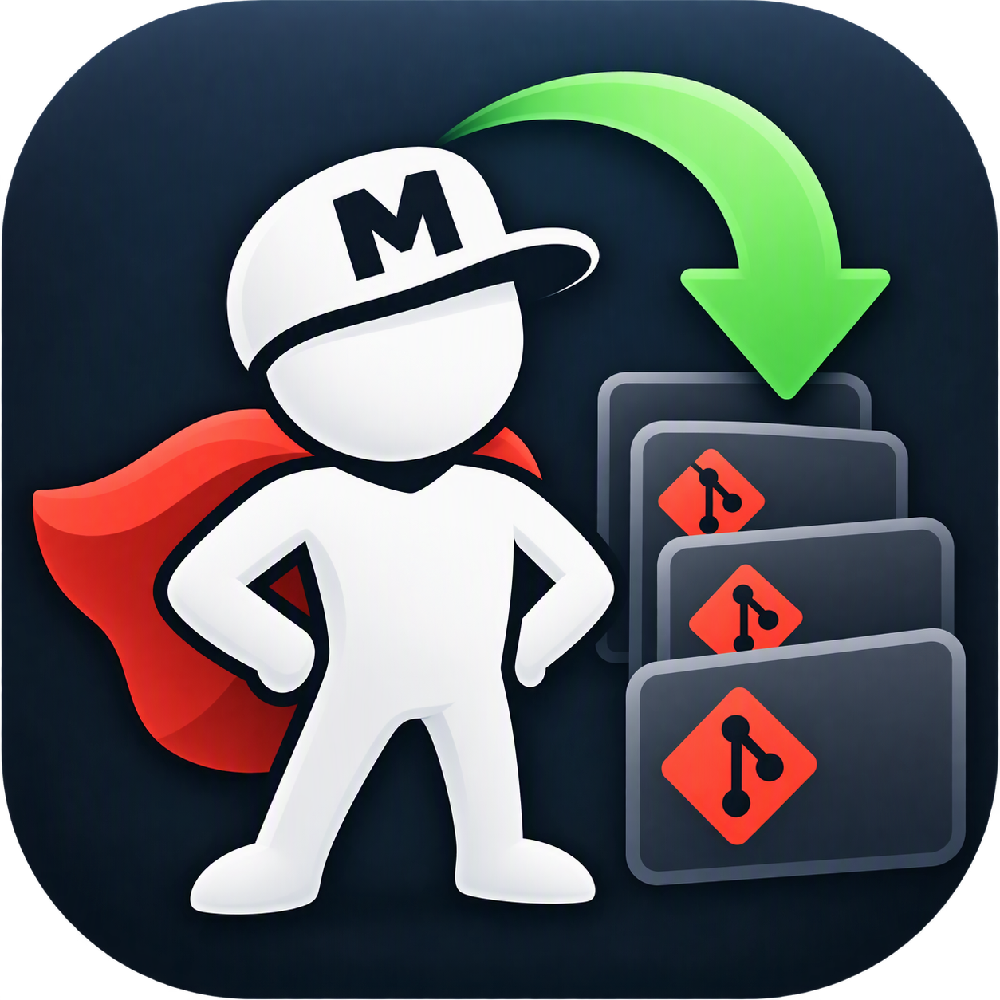

<div align="center">



# MainStay

**Keep your local repositories anchored to main.**

A high-performance, safe Windows desktop utility to batch-update and align all your local Git repositories in parallel.

[](https://dotnet.microsoft.com/)
[](https://microsoft.com/windows)
[](#tests)
[](LICENSE)

</div>

---

## 💡 Why MainStay?

If you work on dozens of active repositories—across microservices, client libraries, client projects, or open-source forks—keeping your local `main` branches up to date is tedious and time-consuming.

Doing this by hand or running blunt bash scripts often leads to:
- Dirty working tree errors or merge conflicts.
- Lost work when switching branches without stashing.
- Getting left on the wrong branch or stranded in a detached `HEAD`.
- Stalled networks or CPU spikes from unthrottled concurrent pulls.

**MainStay solves this.** It scans your development folder, detects all Git repositories, and runs safe, parallel updates against the primary branch (`main`, `master`, or your custom default)—all wrapped in a clean, modern desktop GUI.

---

## ✨ Features

- ⚡ **Throttled Concurrency** — Batch-process hundreds of repositories in parallel with configurable worker limits (default: 10 parallel workers) to prevent network and I/O congestion.
- 🛡️ **Zero Work Loss Guarantee** — Any uncommitted changes are safely stashed and restored. MainStay remembers your original branch (or detached commit) and puts everything back exactly how it was found.
- ⏭️ **Intelligent Skip** — Fetches remote references first. If your local `main` is already up to date, it skips unnecessary branch checkouts and stash cycles entirely.
- 🎯 **Configurable Main Resolution** — Resolves branches dynamically (e.g. `main, master`) prioritizing remote defaults.
- 📌 **"Stay on Main" Option** — Toggle whether to restore your prior working branch or stay checked out on `main` after pulling.
- 📊 **Real-Time Audit Grid** — Inspect exact commit changes (`FromCommit` ➜ `ToCommit`), commit counts, duration, stashing status, and clear error diagnostics.
- 💾 **Export Results** — Export full run logs to **CSV** or **JSON** for team tracking, reporting, or automation scripts.

---

## 🔒 Safety & Lifecycle Workflow

MainStay follows a defensive, non-destructive workflow for every repository:

```
[Scan Folder] ➜ [Detect Git Repo] ➜ [Fetch origin]
                                          │
                   ┌──────────────────────┴──────────────────────┐
                   ▼                                             ▼
          Already Up to Date                             New Commits Found
                   │                                             │
      (Skip checkout/stash cycle)                 1. Stash uncommitted changes
                   │                              2. Checkout main branch
                   │                              3. Fast-forward pull
                   │                              4. Restore original branch / commit
                   │                              5. Pop stash safely
                   └──────────────────────┬──────────────────────┘
                                          ▼
                               [Report Status & Timing]
```

If a merge conflict, dirty pop, or network failure occurs at any stage, MainStay captures the exact error details without corrupting your repository state.

---

## 🚀 Getting Started

### Prerequisites

- [Windows 10 / 11](https://www.microsoft.com/windows)
- [.NET 10.0 SDK](https://dotnet.microsoft.com/download) or higher
- [Git](https://git-scm.com/) installed and available in your system `PATH`

### Installation & Running

1. **Clone the repository:**
   ```bash
   git clone https://github.com/your-username/mainstay.git
   cd mainstay
   ```

2. **Build and run:**
   ```bash
   dotnet run --project MainStay/MainStay.csproj
   ```

Alternatively, open `MainStay.slnx` in Visual Studio 2026, JetBrains Rider, or VS Code with C# Dev Kit.

---

## ⚙️ Configuration

| Option | Default | Description |
|---|---|---|
| **Root folder** | Current Directory | The parent folder to recursively scan for Git repositories. |
| **Main branch names** | `main, master` | Comma-separated list of branch names to target, evaluated in priority order. |
| **Parallel repositories** | `10` | Maximum number of repositories to update concurrently (1 – 64). |
| **Git timeout** | `120s` | Maximum time allowed per repository operation before timeout. |
| **Stay on main** | `false` | When enabled, leaves each repository checked out on `main` instead of restoring the original branch. |

---

## 🧪 Tests

MainStay includes a comprehensive suite of unit and integration tests using [xUnit v3](https://xunit.net/) and [FluentAssertions](https://fluentAssertions.com/), testing against isolated Git sandbox repositories:

```bash
dotnet test
```

---

## 🤝 Contributing

Contributions, bug reports, and feature requests are welcome!

1. Fork the repository
2. Create your feature branch (`git checkout -b feature/amazing-feature`)
3. Commit your changes (`git commit -m "Add amazing feature"`)
4. Push to the branch (`git push origin feature/amazing-feature`)
5. Open a Pull Request

---

## 📄 License

This project is licensed under the [MIT License](LICENSE).
